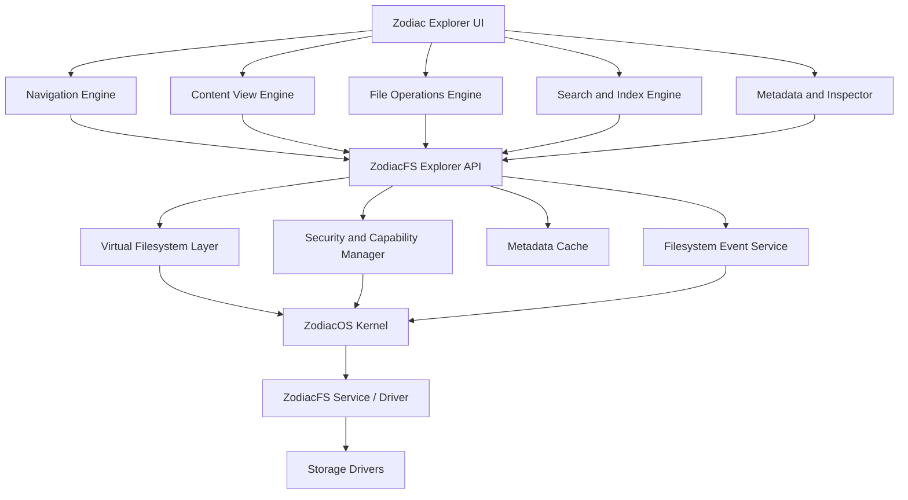
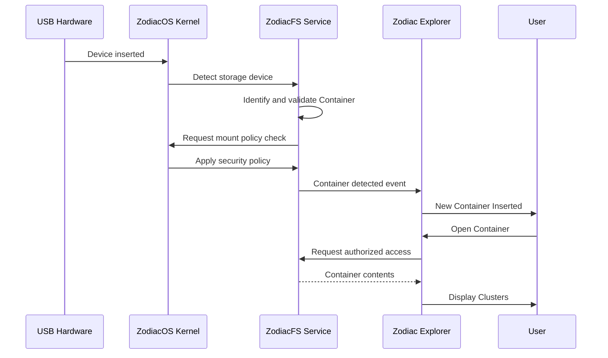

# Zodiac Explorer
## ZodiacOS Native Filesystem Explorer — Architecture and Design

> **Purpose:** Define the architecture, navigation model, interfaces, security boundaries, user experience, and implementation roadmap for Zodiac Explorer, the native file-management environment of ZodiacOS.

---

## Table of Contents

1. [Vision and Design Principles](#1-vision-and-design-principles)
2. [ZodiacFS Concepts and Hierarchy](#2-zodiacfs-concepts-and-hierarchy)
3. [Navigation Model](#3-navigation-model)
4. [Desktop User Interface](#4-desktop-user-interface)
5. [Application Architecture](#5-application-architecture)
6. [Navigation Engine](#6-navigation-engine)
7. [ZodiacFS Explorer API](#7-zodiacfs-explorer-api)
8. [Object Identity and Metadata](#8-object-identity-and-metadata)
9. [Specialized Interfaces](#9-specialized-interfaces)
10. [Filesystem Events and Device Detection](#10-filesystem-events-and-device-detection)
11. [File Operations](#11-file-operations)
12. [Search and Indexing](#12-search-and-indexing)
13. [Performance and Scalability](#13-performance-and-scalability)
14. [Security Architecture](#14-security-architecture)
15. [Error Handling and Reliability](#15-error-handling-and-reliability)
16. [Suggested Rust Project Structure](#16-suggested-rust-project-structure)
17. [Development Roadmap](#17-development-roadmap)
18. [Architectural Decisions and Future Considerations](#18-architectural-decisions-and-future-considerations)

---

## 1. Vision and Design Principles

**Zodiac Explorer** is the native file explorer and filesystem-management application of ZodiacOS. It is designed specifically around ZodiacFS rather than being a direct recreation of Windows File Explorer or macOS Finder.

Its purpose is to let users navigate, organize, inspect, search, transfer, and securely manage the objects stored in ZodiacFS.

### Core design principle

> Users navigate through storage structures, not merely through conventional directories and drive letters.

Zodiac Explorer should expose the concepts of ZodiacFS in a clear, understandable desktop experience. It should make Containers, Clusters, Packages, Folders, and Items discoverable without forcing users to understand low-level filesystem implementation details.

### Primary goals

- Provide a native graphical interface for ZodiacFS.
- Make the ZodiacFS hierarchy understandable and navigable.
- Support multiple Containers and removable storage.
- Provide familiar file-management operations.
- Integrate with ZodiacOS security and capability systems.
- Support Bundles and Capsules without confusing them with the core hierarchy.
- Scale to large directories and large storage volumes.
- Provide filesystem functionality to third-party applications through stable interfaces.
- Keep the graphical application independent of the filesystem's internal implementation.

### Architectural principle

The explorer must not directly manipulate raw disk sectors or depend on private on-disk structures. It communicates through a defined ZodiacFS interface and the appropriate ZodiacOS IPC and security mechanisms.

---

## 2. ZodiacFS Concepts and Hierarchy

The explorer must preserve the agreed ZodiacFS object model.

### 2.1 Core hierarchy

```text
Container
└── Cluster
    └── Package
        ├── Folder
        │   └── Item
        └── Item
```

| Concept | Meaning | Explorer responsibility |
|---|---|---|
| **Container** | A ZodiacFS filesystem volume. It may occupy a partition or another supported storage region; it is not necessarily an entire physical drive. | Display, inspect, mount, unmount, and manage the volume through authorized system operations. |
| **Cluster** | A collection of related Packages. | Display and organize related Packages. |
| **Package** | A logical collection containing Folders and Items. | Display and manage its contents. |
| **Folder** | An organizational object that contains Items. | Allow users to browse its contents. |
| **Item** | An individual filesystem data object. | Display metadata, preview, open, copy, move, rename, and delete according to permissions. |

The explorer must preserve the agreed hierarchy and must not silently reinterpret these concepts as ordinary drive-letter paths.

### 2.2 Additional concepts outside the core hierarchy

Two concepts are important to the ZodiacOS experience but should not be inserted as extra levels in the core hierarchy.

#### Bundle

A **Bundle** represents an installed application. It may have:

- A manifest.
- An application identity.
- An entry point.
- A version.
- Dependencies.
- Required and granted permissions.
- References to Packages and other resources.
- Installation and update metadata.

The Bundle Browser should display and manage installed applications. A Bundle is not simply another name for a Package.

#### Capsule

A **Capsule** is a portable collection of unrelated Packages intended for transfer, import, or export. It has its own identity and manifest and may contain multiple Packages that do not belong to one Cluster.

The Capsule Manager should support:

- Creating a Capsule from selected Packages.
- Inspecting its manifest and contents.
- Exporting it.
- Importing it into an authorized destination Container.
- Verifying its integrity.
- Reporting conflicts or unsupported content.

A Capsule is a portability/transfer concept, not another level in the Container → Cluster → Package hierarchy.

### 2.3 Important semantic rule

Clusters organize related Packages, but membership in the same Cluster does **not** automatically grant access to every Package or Item in that Cluster. Authorization is evaluated for the specific object and operation.

---

## 3. Navigation Model

Zodiac Explorer uses an object-aware navigation model. It should not rely only on concatenated path strings.

### 3.1 Navigation behavior

| Current location | Displayed contents |
|---|---|
| Home | Favorite locations, recent locations, and useful entry points |
| Container | Clusters belonging to that Container |
| Cluster | Related Packages |
| Package | Folders and Items |
| Folder | Items and any supported child organizational entries |
| Item | Preview, metadata, or an associated application |
| Bundle Browser | Installed application Bundles |
| Capsule Manager | Portable Capsules and their Package contents |

The Package/Folder/Item rules must follow the actual ZodiacFS data model. If the filesystem permits a more specific nesting rule, the API must expose it explicitly rather than having the UI invent one.

### 3.2 Example navigation

```text
Zodiac Explorer
└── Projects Container
    └── Development Cluster
        └── ZodiacOS Package
            ├── src/
            │   ├── lib.rs
            │   └── memory.rs
            ├── boot/
            │   └── entry.asm
            └── README.md
```

### 3.3 Navigation context

The navigation engine should retain stable object identities and the current selection.

Illustrative Rust model:

```rust
pub struct NavigationContext {
    pub container_id: ContainerId,
    pub cluster_id: Option<ClusterId>,
    pub package_id: Option<PackageId>,
    pub folder_id: Option<FolderId>,
    pub selected_item_ids: Vec<ItemId>,
}
```

The ID types above are illustrative. The implementation should define strong, distinct ID types and use stable filesystem identities rather than relying on names or display paths.

The context should also be able to represent special locations such as Home, Recent, Favorites, search results, Bundles, and Capsules. These may be represented by a separate location enum or view model rather than pretending they are filesystem objects.

### 3.4 Breadcrumb navigation

Display a readable breadcrumb, for example:

```text
Projects > Development > ZodiacOS > src
```

Each breadcrumb segment should be clickable and navigate to that object's location.

The explorer should support:

- Back and forward navigation.
- Breadcrumb navigation.
- Keyboard navigation.
- Opening locations in new tabs.
- Multiple tabs.
- Restoring previous navigation sessions.
- Selecting and opening objects.
- Copying an object's reference or location.
- Dragging objects between authorized destinations.
- Preserving selection where appropriate after navigation or refresh.

A human-readable breadcrumb is a presentation of object relationships. It is not the authoritative object identity.

---

## 4. Desktop User Interface

Zodiac Explorer should use a consistent multi-region desktop layout.

### 4.1 Main interface regions

| Region | Responsibility |
|---|---|
| Top toolbar | Back/forward, navigation actions, breadcrumbs, search, view controls, and contextual actions |
| Sidebar | Containers, Clusters, favorites, recent locations, special locations, and devices |
| Main content area | Displays the current location's Packages, Folders, and Items |
| Inspector panel | Displays selected-object metadata, ownership, permissions, and other properties |
| Bottom status bar | Selection count, item count, operation status, and relevant storage information |

### 4.2 Suggested sidebar

```text
ZODIAC EXPLORER

  FAVORITES
    Home
    Recent
    Starred

  CONTAINERS
    System
      System Cluster
      Applications Cluster

    Data
      Personal Cluster
      Work Cluster

    Projects
      Development Cluster
      Research Cluster

  DEVICES
    ZodiacOS SSD
    USB Storage

  SPECIAL
    Bundles
    Capsules
    Trash
```

This is an illustrative layout. Actual Container and Cluster names must come from the filesystem, not be hardcoded.

The sidebar should support:

- Expand/collapse for Containers and Clusters.
- Selection and context menus.
- Drag-and-drop where the operation is supported and authorized.
- Container status indicators.
- Removable-device indicators.
- Favorites and recent locations.
- Clear indication of unavailable, unmounted, or disconnected locations.

### 4.3 Content views

The Content View Engine should support:

- **Grid view:** visual icons and thumbnails.
- **List view:** compact rows for browsing.
- **Column view:** hierarchical browsing across adjacent levels.
- **Details view:** metadata-rich rows.
- Sorting and filtering.
- File previews where supported.
- Context menus.
- Multi-selection.
- Keyboard shortcuts.
- Accessible labels and focus behavior.

The selected view should be restorable per location or according to user preferences.

### 4.4 Contextual actions

Actions should depend on the selected object's type and the user's permissions.

Examples:

- Container: inspect, mount, unmount, eject, or open Container Manager.
- Cluster: inspect and browse Packages.
- Package: open, inspect, rename, move, or manage contents.
- Folder: open, copy, move, rename, or delete.
- Item: preview, open with an associated application, copy, move, rename, or delete.
- Bundle: open, inspect, update, or uninstall.
- Capsule: inspect, verify, import, or export.

Unavailable or unauthorized actions should be disabled or explain why they cannot be performed. Hiding an action must never be the only security enforcement; the service and kernel must still validate it.

---

## 5. Application Architecture

Zodiac Explorer should be divided into independent subsystems.

### 5.1 High-level architecture



This diagram is a logical dependency view. It does not require every subsystem to be a separate process. The implementation may use libraries and in-process modules inside Zodiac Explorer, while filesystem and security authority remain in the appropriate ZodiacOS services and kernel components.

### 5.2 Subsystem responsibilities

#### Navigation Engine

Responsible for:

- Opening Containers.
- Navigating Clusters.
- Entering Packages.
- Browsing Folders.
- Opening Items.
- Breadcrumb navigation.
- Back and forward history.
- Tab management.
- Restoring navigation sessions.

#### Content View Engine

Responsible for:

- Grid, list, column, and details views.
- Sorting and filtering.
- Selection and multi-selection.
- File previews.
- Context menus.
- Incremental content rendering.
- View preferences.

#### File Operations Engine

Responsible for:

- Copy.
- Move.
- Rename.
- Delete.
- Restore.
- Import and export.
- Capsule creation and extraction.
- Operation progress and cancellation.
- Conflict reporting.
- Safe handling of interrupted operations.

Formatting a Container is a privileged Container-management workflow. It must not be implemented as an ordinary file operation.

#### Search and Index Engine

Responsible for:

- Item-name searches.
- Package searches.
- Cluster searches.
- Metadata searches.
- Content indexing where supported and authorized.
- Incremental index updates.
- Search filtering and result navigation.

#### Metadata and Inspector

Responsible for:

- Object identity.
- Object type.
- Parent identity.
- Creation and modification timestamps.
- Size.
- Ownership.
- Permissions and ACL information.
- Integrity information.
- Other filesystem-specific properties.

#### Security Integration

Responsible for:

- Permission inspection.
- Capability requests.
- Secure object handles.
- Authorization feedback.
- Access-denied handling.
- Permission-change workflows.
- Preventing stale cached state from being treated as authorization.

---

## 6. Navigation Engine

The Navigation Engine is the central subsystem responsible for moving through the ZodiacFS hierarchy.

### 6.1 Responsibilities

- Resolve a requested object identity.
- Determine the object's type.
- Request authorized enumeration of its children.
- Select the appropriate view for that object type.
- Maintain navigation history.
- Maintain breadcrumbs.
- Manage tabs and selected objects.
- Handle deleted, disconnected, or inaccessible locations.
- Refresh a view in response to filesystem events.

### 6.2 Object-aware navigation

The engine must know what kind of object the user is opening and what kinds of children are valid for that location.

For example:

1. Opening a Container requests its Clusters.
2. Opening a Cluster requests its Packages.
3. Opening a Package requests its Folders and Items.
4. Opening a Folder requests its contents.
5. Opening an Item requests preview or application-opening behavior.

The UI should not assume that every object is a directory or that every object can be opened in the same way.

### 6.3 History and tabs

Each tab should maintain its own:

- Current location.
- Back history.
- Forward history.
- Selected object identities.
- View mode and relevant view state.
- Pending loading or operation state.

History entries should use stable identities and enough context to recover gracefully if an object is renamed, moved, deleted, or becomes inaccessible.

---

## 7. ZodiacFS Explorer API

The UI must not communicate directly with raw disk sectors or private on-disk structures.

Create a dedicated Explorer API between Zodiac Explorer and ZodiacFS. The API should provide typed operations and a stable contract for listing, inspecting, opening, and modifying filesystem objects.

### 7.1 Illustrative Rust interface

```rust
pub trait ZodiacFSExplorer {
    fn list_containers(
        &self,
    ) -> Result<Vec<ContainerInfo>, FsError>;

    fn list_clusters(
        &self,
        container: ContainerId,
    ) -> Result<Vec<ClusterInfo>, FsError>;

    fn list_packages(
        &self,
        cluster: ClusterId,
    ) -> Result<Vec<PackageInfo>, FsError>;

    fn list_package_contents(
        &self,
        package: PackageId,
    ) -> Result<PackageContents, FsError>;

    fn list_folder_items(
        &self,
        folder: FolderId,
    ) -> Result<Vec<ItemInfo>, FsError>;

    fn get_metadata(
        &self,
        object: ObjectId,
    ) -> Result<ObjectMetadata, FsError>;
}
```

This is a conceptual API, not a final ABI. It should be refined to match ZodiacFS's actual object model, error types, asynchronous execution model, and IPC transport.

### 7.2 Production API requirements

The production interface should consider:

- Asynchronous requests.
- Pagination or cursor-based enumeration.
- Stable object identifiers.
- Secure handles or validated object references.
- Explicit authorization failures.
- Cancellation for long-running requests.
- Versioned IPC/API contracts.
- Event subscriptions.
- Bounded request and response sizes.
- Typed operation results.
- Consistent error reporting.

The explorer should use IPC to communicate with the filesystem service when the service is in a separate process or protection domain. A Rust trait may define the client-side abstraction, but it does not replace the IPC protocol.

### 7.3 API operation categories

A fuller API will likely include:

| Category | Example operations |
|---|---|
| Discovery | List Containers, enumerate Clusters |
| Enumeration | List Packages, list Package contents, list Folder contents |
| Metadata | Get metadata, inspect object type, inspect ownership |
| Handles | Open object, validate handle, close handle |
| Mutation | Create, rename, copy, move, delete |
| Security | Inspect permissions, request capability, change permissions |
| Storage | Mount, unmount, eject, inspect Container status |
| Search | Submit query, fetch next page, cancel query |
| Events | Subscribe, receive event, unsubscribe |
| Transfer | Create Capsule, inspect Capsule, import/export |

All operations must be validated by the responsible system service and security boundary.

---

## 8. Object Identity and Metadata

Every filesystem object should have a stable identity that does not depend on its display name or current location.

### 8.1 Illustrative metadata structure

```rust
pub struct ObjectMetadata {
    pub id: ObjectId,
    pub name: String,
    pub object_type: ObjectType,
    pub parent_id: Option<ObjectId>,
    pub created_at: Timestamp,
    pub modified_at: Timestamp,
    pub size: u64,
    pub permissions: Permissions,
}
```

Illustrative object types:

```rust
pub enum ObjectType {
    Container,
    Cluster,
    Package,
    Folder,
    Item,
    Bundle,
    Capsule,
}
```

Bundle and Capsule should have specialized metadata structures because they have application and portability semantics beyond ordinary filesystem objects.

### 8.2 Metadata considerations

The final metadata model should define:

- Stable object ID format and scope.
- Parent relationship.
- Object type.
- Display name and naming rules.
- Creation and modification timestamps.
- Logical and allocated size where applicable.
- Ownership.
- Permissions and ACL references.
- Integrity state.
- Version or generation information if supported.
- Container identity.
- Relevant Package, Cluster, or Folder relationship.

The UI should distinguish unavailable metadata from zero or empty values.

---

## 9. Specialized Interfaces

Zodiac Explorer should expose dedicated interfaces for major ZodiacFS and ZodiacOS concepts.

### 9.1 Container Manager

Displays:

- Container identity.
- Capacity and available space.
- Filesystem health.
- Mount status.
- Security status.
- Backing device or partition information where permitted.

Actions:

- Mount.
- Unmount.
- Inspect.
- Format.
- Eject.

Formatting is destructive and must require strong authorization, explicit confirmation, and safeguards against formatting an active or protected system Container.

A Container is a filesystem volume, not necessarily an entire physical drive. A Container may exist on a drive partition, and a USB drive may be formatted as a Container.

### 9.2 Bundle Browser

Displays:

- Installed application Bundles.
- Application name and identity.
- Version.
- Entry point.
- Dependencies.
- Required and granted permissions.
- Installation status.

Actions:

- Open.
- Inspect.
- Update.
- Uninstall.

The Bundle Browser should integrate with ZodiacOS application-launching and package-management services rather than independently executing application binaries.

### 9.3 Capsule Manager

Displays:

- Portable Capsules.
- Capsule identity and manifest.
- Included Packages.
- Integrity/verification status.
- Transfer and import status.

Actions:

- Create.
- Inspect.
- Export.
- Import.
- Verify integrity.

Import must validate the Capsule and authorize all destination changes. It should report conflicts rather than silently overwriting existing objects.

### 9.4 Security Inspector

Displays, when available and authorized:

- Ownership.
- ACLs.
- Effective permissions.
- Capability requirements.
- Encryption status.
- Integrity status.

Actions:

- Inspect permissions.
- Request authorized permission changes.
- Request access when a capability or authorization workflow is available.

The inspector is a view into security state, not the security authority itself.

---

## 10. Filesystem Events and Device Detection

Zodiac Explorer should subscribe to filesystem events rather than repeatedly polling the filesystem to discover changes.

### 10.1 Illustrative event model

```rust
pub enum ExplorerEvent {
    ContainerInserted(ContainerId),
    ContainerValidated(ContainerId),
    ContainerMounted(ContainerId),
    ContainerUnmounted(ContainerId),
    ContainerRemoved(ContainerId),

    ClusterCreated(ClusterId),
    PackageCreated(PackageId),
    FolderCreated(FolderId),
    ItemCreated(ItemId),

    ObjectModified(ObjectId),
    ObjectDeleted(ObjectId),

    PermissionsChanged(ObjectId),
    StorageCapacityChanged(ContainerId),
}
```

This is an initial event list. The final event protocol should also define rename/move events, operation identifiers, event sequence or generation information, overflow/resynchronization behavior, and subscription lifecycle.

### 10.2 USB insertion workflow



### 10.3 Device and Container safety

- Never automatically format an unknown USB device.
- Identify and validate a Container before treating it as a usable ZodiacFS volume.
- Apply mount and access policies.
- Require user approval where the configured policy demands it.
- Do not allow an external Container to overwrite protected system files merely because it is mounted.
- Notify the user when a new Container is detected.
- Handle removal while browsing or copying.
- Invalidate stale handles and cached metadata after removal.
- Provide safe unmount/eject workflows.

---

## 11. File Operations

The File Operations Engine should provide a consistent workflow for modifying objects.

### 11.1 Supported operations

- Copy.
- Move.
- Rename.
- Delete.
- Restore.
- Import.
- Export.
- Create supported objects.
- Create and extract Capsules.
- View operation progress.
- Cancel operations where cancellation is safe and supported.

### 11.2 Cross-Container operations

Moving or copying between Containers requires:

1. Authorization to read the source.
2. Authorization to create or write at the destination.
3. Validation of source and destination identities.
4. Conflict detection.
5. Safe handling of partial failure.
6. Clear reporting of whether the operation copied, moved, or failed.

A cross-Container move may need to be implemented as copy followed by source deletion. It must not be presented as an atomic operation unless the underlying implementation can guarantee atomicity.

### 11.3 Operation management

Long-running operations should expose:

- Progress.
- Current source and destination.
- Bytes or objects processed where meaningful.
- Estimated remaining work only when it can be calculated responsibly.
- Cancellation state.
- Errors and conflicts.
- Completion status.

Interrupted operations must not leave the UI claiming success when the filesystem has not confirmed it.

---

## 12. Search and Indexing

Search should operate across the ZodiacFS object model.

### 12.1 Search scopes

- Current Folder.
- Current Package.
- Current Cluster.
- Current Container.
- All accessible Containers.
- Bundles.
- Capsules.

### 12.2 Search types

- Item-name search.
- Package-name search.
- Cluster-name search.
- Metadata search.
- Content search where supported.
- Filters by object type, size, date, and other available metadata.

### 12.3 Indexing requirements

- Incremental indexing.
- Background index updates.
- Filesystem-event-driven invalidation or updates.
- Permission-aware search results.
- Cancellation.
- Paginated results.
- Recovery or rebuild after index corruption.
- Respect for excluded or unsupported content.

An index is an optimization, not an authorization source. Search must not reveal objects or metadata the requesting user/process is not allowed to discover.

---

## 13. Performance and Scalability

Zodiac Explorer should be designed for large filesystems from the beginning.

| Area | Recommended approach |
|---|---|
| Directory/Package loading | Asynchronous enumeration |
| Large directories | Virtualized lists and grids |
| Metadata | Incremental loading |
| Thumbnails | Background workers and bounded caches |
| Search | Indexed search with pagination |
| Updates | Filesystem event subscriptions |
| Caching | In-memory metadata cache |
| Copy/move | Asynchronous operation workers |
| Preview | Separate, resource-limited preview workers |
| Cancellation | Cancellation tokens or equivalent request cancellation |

### 13.1 Large-directory behavior

Opening a Package containing 100,000 Items must not require the GUI to load and render all 100,000 metadata records simultaneously.

Use:

- Cursor-based or paginated enumeration.
- UI virtualization.
- Visible-item metadata loading.
- A small prefetch window.
- Bounded thumbnail and metadata caches.
- Cancellation when the user navigates away.
- Backpressure so the UI cannot enqueue unlimited work.

### 13.2 Cache correctness

Cached metadata may become stale after:

- Rename or move.
- Delete.
- Permission changes.
- Container unmount or removal.
- Filesystem recovery.
- External modification.

Use event-driven invalidation and generation/version checks where available. Never treat cached permissions as proof that an operation is authorized.

---

## 14. Security Architecture

Zodiac Explorer must never become a mechanism for bypassing ZodiacOS security.

### 14.1 Security responsibilities

1. The kernel enforces the relevant protection boundaries.
2. The filesystem service validates access to filesystem objects.
3. The explorer requests capabilities or authorization for protected operations.
4. Objects are accessed through validated identities or secure handles.
5. Moving an object between Containers requires authorization at both source and destination.
6. Permission changes require appropriate authority.
7. Sensitive operations provide a clear authorization workflow.
8. Cached metadata is never treated as authorization.
9. The UI cannot grant itself permissions by changing its own state or hiding an error.
10. The same security rules apply to third-party applications using the Explorer API.

### 14.2 Cluster membership is not permission

A Cluster is an organizational collection of related Packages. It does not create an automatic security boundary or grant inherited access unless ZodiacFS's explicitly defined permission model says so.

### 14.3 Permission-aware UI

The explorer should:

- Display permission information only when authorized.
- Distinguish access denied from object not found where policy permits.
- Explain why an action is unavailable when safe to do so.
- Request authorization through the system's trusted mechanism.
- Refresh security metadata after permission changes.
- Avoid trusting client-side permission checks as final decisions.

### 14.4 Secure object access

The API should prefer validated handles or object references with clearly defined lifetime and authority. It should define behavior for:

- Stale handles.
- Revoked capabilities.
- Deleted objects.
- Unmounted Containers.
- Disconnected devices.
- Changed permissions.
- Expired authorization.

---

## 15. Error Handling and Reliability

The explorer should present clear, recoverable errors.

Examples include:

- Container not found.
- Container unavailable.
- Container validation failed.
- Container not mounted.
- Cluster not found.
- Package not found.
- Item not found.
- Permission denied.
- Capability required.
- Storage full.
- I/O error.
- Name conflict.
- Unsupported operation.
- Operation cancelled.
- Device removed.
- Stale object handle.
- Index unavailable.

The internal API should use typed errors. The UI should translate them into understandable messages without exposing sensitive internal details.

The explorer should also handle:

- Filesystem service restarts.
- IPC disconnection.
- Event stream interruption.
- Event queue overflow.
- Cache invalidation.
- Interrupted operations.
- Unexpected device removal.
- Partial copy/import failures.

After an event stream interruption, the explorer should resynchronize its view with authoritative filesystem state rather than assuming it received every event.

---

## 16. Suggested Rust Project Structure

The following is a proposed application-side layout. It is a starting point, not a requirement that every module be a separate crate.

```text
zodiac-explorer/
├── Cargo.toml
└── src/
    ├── main.rs
    │
    ├── application/
    │   ├── app.rs
    │   ├── state.rs
    │   └── commands.rs
    │
    ├── navigation/
    │   ├── engine.rs
    │   ├── context.rs
    │   ├── history.rs
    │   ├── breadcrumb.rs
    │   └── tabs.rs
    │
    ├── views/
    │   ├── home.rs
    │   ├── container.rs
    │   ├── cluster.rs
    │   ├── package.rs
    │   ├── folder.rs
    │   ├── item.rs
    │   └── inspector.rs
    │
    ├── operations/
    │   ├── copy.rs
    │   ├── move.rs
    │   ├── rename.rs
    │   ├── delete.rs
    │   ├── restore.rs
    │   └── transfer.rs
    │
    ├── search/
    │   ├── engine.rs
    │   ├── index.rs
    │   └── query.rs
    │
    ├── security/
    │   ├── permissions.rs
    │   ├── authorization.rs
    │   └── capabilities.rs
    │
    ├── metadata/
    │   ├── object.rs
    │   └── properties.rs
    │
    ├── integrations/
    │   ├── zodiacfs.rs
    │   ├── bundles.rs
    │   ├── capsules.rs
    │   └── containers.rs
    │
    └── events/
        ├── filesystem.rs
        └── notifications.rs
```

### 16.1 Architectural boundaries

- `application/` coordinates UI state and commands.
- `navigation/` owns location, history, breadcrumbs, and tabs.
- `views/` presents object-specific content.
- `operations/` coordinates filesystem mutations.
- `search/` handles queries and index interaction.
- `security/` integrates with trusted authorization and capability services.
- `metadata/` models object properties.
- `integrations/` connects to ZodiacFS and specialized system services.
- `events/` handles event subscriptions and notifications.

The application should depend on public API contracts, not private ZodiacFS implementation modules.

---

## 17. Development Roadmap

Implement Zodiac Explorer incrementally. The first milestone should prove that the explorer can navigate the entire agreed hierarchy through real ZodiacFS interfaces.

### Stage 1 — Filesystem Navigation

- [ ] Container listing.
- [ ] Cluster listing.
- [ ] Package browsing.
- [ ] Folder browsing.
- [ ] Item listing.
- [ ] Breadcrumb navigation.
- [ ] Back and forward navigation.
- [ ] Stable object identities in navigation state.
- [ ] Correct handling of inaccessible and unavailable locations.

**Milestone:** A working explorer that can navigate `Container → Cluster → Package → Folder → Item`.

### Stage 2 — Desktop Experience

- [ ] Grid view.
- [ ] List view.
- [ ] Column view.
- [ ] Details view.
- [ ] Sidebar.
- [ ] Tabs.
- [ ] Context menus.
- [ ] Inspector panel.
- [ ] Sorting and filtering.
- [ ] Keyboard navigation.
- [ ] View preferences.

**Milestone:** A usable native desktop file-management interface.

### Stage 3 — File Operations

- [ ] Copy.
- [ ] Move.
- [ ] Rename.
- [ ] Delete.
- [ ] Restore.
- [ ] Drag and drop.
- [ ] Progress monitoring.
- [ ] Cancellation.
- [ ] Conflict handling.
- [ ] Cross-Container authorization.

**Milestone:** Users can safely manage filesystem objects.

### Stage 4 — Advanced ZodiacFS Integration

- [ ] Container Manager.
- [ ] Cluster management.
- [ ] Bundle Browser.
- [ ] Capsule Manager.
- [ ] USB detection.
- [ ] Container insertion notifications.
- [ ] Mount and unmount workflows.
- [ ] Import/export workflows.

**Milestone:** Zodiac Explorer exposes the distinctive ZodiacFS and ZodiacOS concepts.

### Stage 5 — Security and Performance

- [ ] Permission inspector.
- [ ] Capability authorization.
- [ ] Secure object handles.
- [ ] Metadata caching.
- [ ] Search indexing.
- [ ] Background workers.
- [ ] Virtualized large-directory views.
- [ ] Event-driven refresh.
- [ ] Recovery after service or event-stream interruption.
- [ ] Large-filesystem optimization.

**Milestone:** A secure, scalable explorer suitable for everyday ZodiacOS use.

---

## 18. Architectural Decisions and Future Considerations

### 18.1 Keep the explorer independent from the filesystem implementation

Build Zodiac Explorer as a native Rust application that consumes public ZodiacFS interfaces. Do not tightly couple its UI to the filesystem's internal structures.

This separation allows:

- ZodiacFS implementation changes without rewriting the UI.
- Multiple applications to use the same filesystem API.
- Third-party developers to build compatible applications.
- Security enforcement to remain outside the graphical application.
- Independent testing of filesystem services and desktop behavior.

### 18.2 Separate kernel/filesystem work from desktop work

**Kernel and filesystem side:**

- ZodiacFS operations.
- Object identity and metadata.
- IPC interfaces.
- Authorization and capabilities.
- Filesystem event notifications.
- Storage and Container integration.

**Desktop/application side:**

- Zodiac Explorer UI.
- Navigation engine.
- Breadcrumbs and tabs.
- Content views.
- Inspector.
- Search interface.
- File-operation workflows.
- Bundle and Capsule interfaces.

### 18.3 Make the Explorer API reusable

The Explorer API should eventually be a public, documented interface for third-party applications. Other applications should not need to implement their own raw ZodiacFS access.

The API should expose only supported operations and enforce the same authorization rules for every client.

### 18.4 First implementation milestone

Do not begin by implementing every visual feature, Bundle workflow, or Capsule workflow at once.

First implement and test:

```text
Container
   ↓
Cluster
   ↓
Package
   ↓
Folder
   ↓
Item
```

Prove that each navigation step:

1. Uses a stable object identity.
2. Requests data from the ZodiacFS interface.
3. Handles success and failure.
4. Respects authorization.
5. Can be refreshed after filesystem events.

Then build the graphical experience on top of that foundation.

---

## Final Design Principle

**Zodiac Explorer is the user's window into ZodiacFS.**

It should make the filesystem's organization visible, keep storage management understandable, provide familiar desktop interactions, and preserve ZodiacOS's security model.

Its foundation is the navigation hierarchy:

**Container → Cluster → Package → Folder → Item**

Bundles and Capsules are first-class system concepts with dedicated interfaces, but remain distinct from that core hierarchy.

The long-term goal is not merely to create another file manager. It is to establish the native filesystem experience and reusable application-facing interface for the entire ZodiacOS ecosystem.
